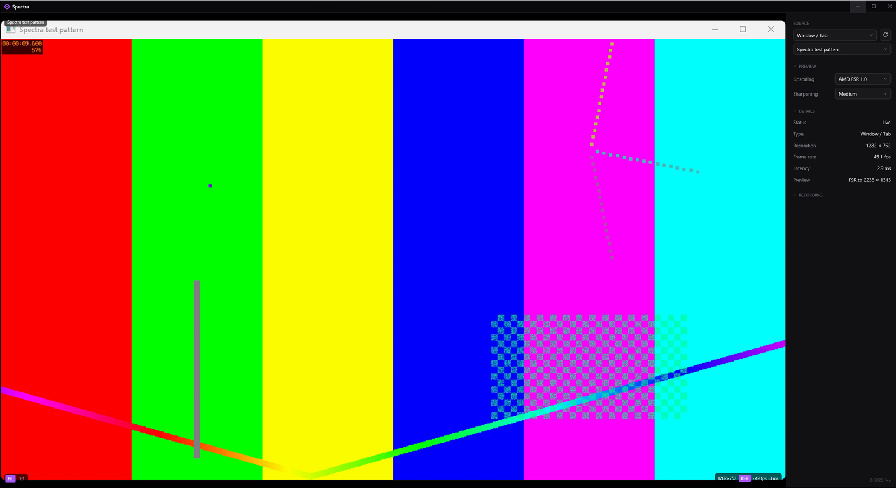

<p align="center"></p>

Preview, record and screenshot your desktop, a window, a capture card or a camera.



## Run

Needs [Rust](https://rustup.rs) and, for recording and capture devices, [ffmpeg](https://ffmpeg.org) on your `PATH`.

```
cargo run --release
```

The Microsoft Store package is built from [`packaging/windows`](packaging/windows).

FSR 1.0 shaders in `src/shaders` are © AMD, [MIT licence](src/shaders/LICENSE-FSR.txt).
