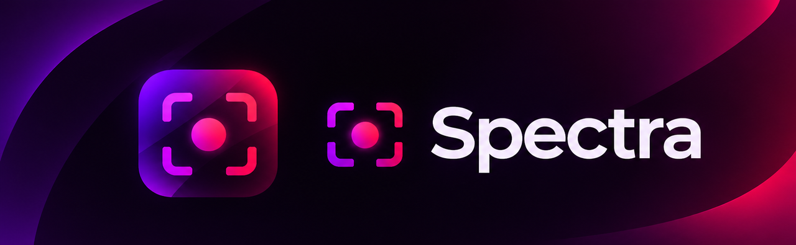

<p align="center"></p>

Preview, record and screenshot your desktop, a window, a capture card or a camera.


## Run

Needs [Rust](https://rustup.rs) and, for recording and capture devices, [ffmpeg](https://ffmpeg.org) on your `PATH`.

```
cargo run --release
```

CI builds a package for each platform: the Microsoft Store package ([`packaging/windows`](packaging/windows)), `Spectra.app` for macOS ([`packaging/macos`](packaging/macos)) and a tarball with a desktop entry for Linux ([`packaging/linux`](packaging/linux)).

FSR 1.0 shaders in `src/shaders` are © AMD, [MIT licence](src/shaders/LICENSE-FSR.txt).
